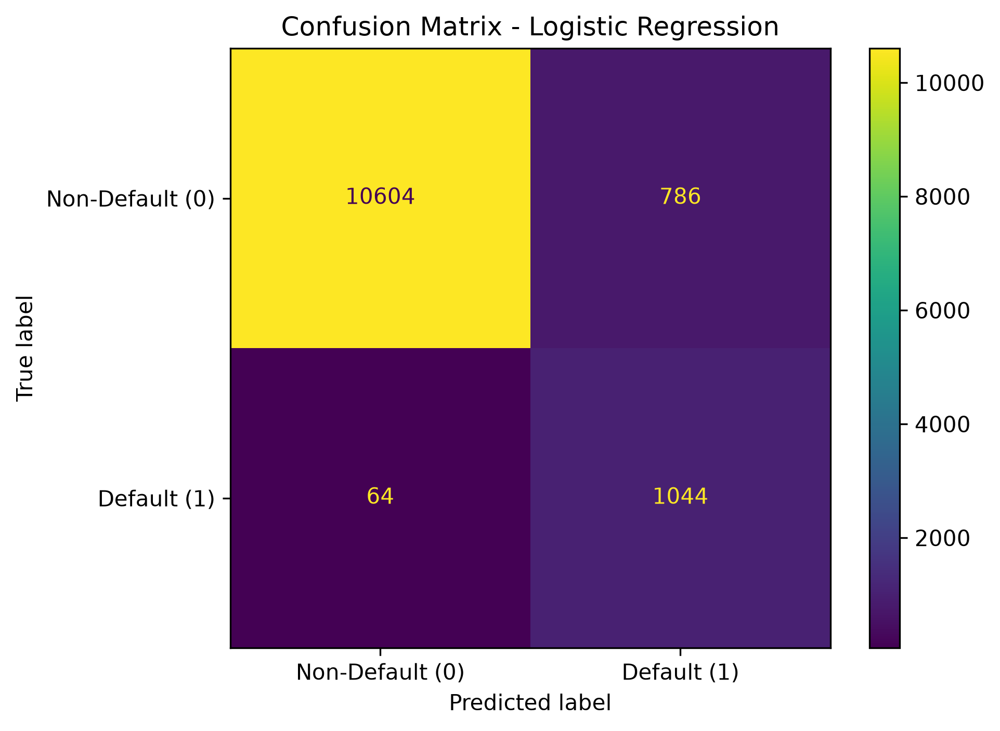
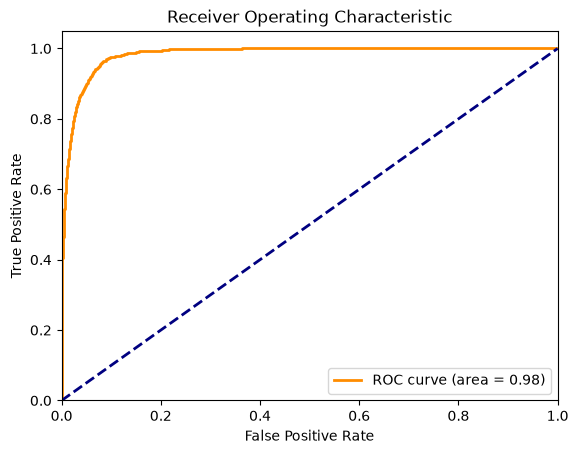
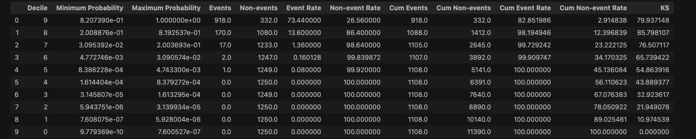
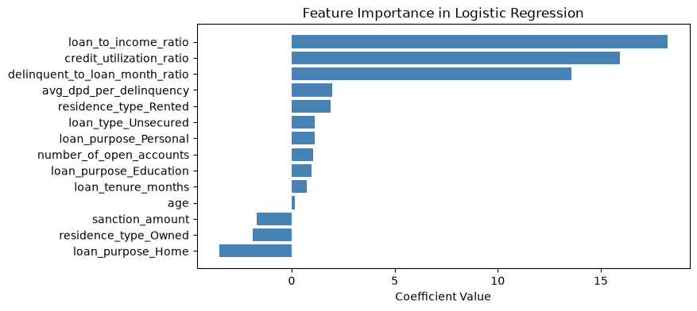
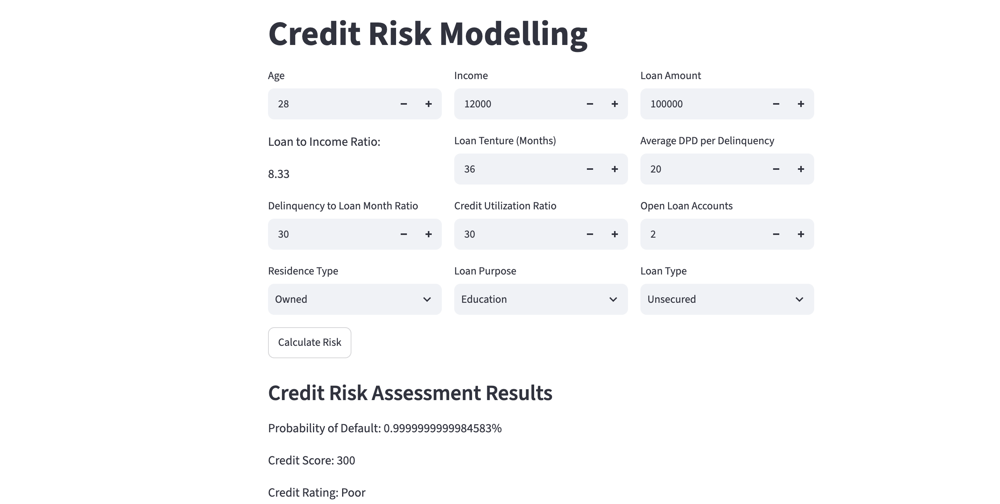

# Credit Risk Prediction Using Machine Learning

An end-to-end machine learning project for predicting the probability of loan default and converting the predicted risk into an interpretable credit score and rating.

This is an educational portfolio project based on a fictional NBFC credit-risk case study. The project covers data preprocessing, feature engineering, feature selection, class-imbalance handling, model development, evaluation, credit scoring, and deployment through an interactive Streamlit application.

> 🔗 **Live Demo:** https://credit-risk-prediction-using-machine-learning.streamlit.app/

---

## 📌 Project Overview

Financial institutions need to evaluate the likelihood that a borrower may default before approving a loan.

The goal of this project is to build a machine learning model that:

- Predicts the **probability of loan default**
- Generates a **credit score between 300 and 900**
- Categorizes applicants as:
  - Poor
  - Average
  - Good
  - Excellent
- Provides an interactive interface for real-time credit-risk assessment

---

## 🏦 Business Problem

The model supports credit-risk assessment using customer demographics, loan information, and credit-bureau history.

Instead of relying only on individual variables such as income or loan amount, the project also creates domain-relevant features that better represent borrower affordability and repayment behaviour.

---

## 📊 Dataset

The dataset contains approximately **50,000 customer and loan records** combining information from:

- Customer demographics
- Loan details
- Credit-bureau information
- Historical default behaviour

The target variable is:

```text
default = 0 → Non-default
default = 1 → Default
```

---

## 🔧 Machine Learning Workflow

```text
Raw Data
   ↓
Data Cleaning & EDA
   ↓
Train / Test Split
   ↓
Feature Engineering
   ↓
Multicollinearity Analysis using VIF
   ↓
WOE / Information Value Analysis
   ↓
Feature Selection
   ↓
Scaling & Encoding
   ↓
Model Training
   ↓
Class Imbalance Handling
   ↓
Hyperparameter Tuning
   ↓
Model Evaluation
   ↓
Credit Score & Risk Rating
   ↓
Streamlit Application
```

---

## 🧠 Feature Engineering

Several domain-specific features were created from the original variables.

### Loan-to-Income Ratio

```text
Loan-to-Income Ratio = Loan Amount / Income
```

This represents the loan burden relative to the borrower's income and provides more information than evaluating loan amount or income independently.

### Delinquent-to-Loan-Month Ratio

```text
Delinquent-to-Loan-Month Ratio
= Delinquent Months × 100 / Total Loan Months
```

This normalizes delinquency behaviour by the length of the borrower's credit history.

### Average DPD per Delinquency

```text
Average DPD per Delinquency
= Total Days Past Due / Delinquent Months
```

This captures the **severity of repayment delays**, while the delinquency ratio captures their frequency.

---

## 🎯 Feature Selection

### Variance Inflation Factor (VIF)

VIF was used to identify highly correlated numerical features and reduce multicollinearity, which is particularly important for Logistic Regression.

### Weight of Evidence (WOE) & Information Value (IV)

Information Value was used to estimate the predictive strength of individual features.

Features with:

```text
IV > 0.02
```

were retained.

The final business features included:

```text
credit_utilization_ratio
delinquent_to_loan_month_ratio
loan_to_income_ratio
avg_dpd_per_delinquency
loan_purpose
residence_type
loan_tenure_months
loan_type
sanction_amount
age
number_of_open_accounts
```

Categorical variables were converted into numerical features using one-hot encoding.

---

## ⚖️ Handling Class Imbalance

The target variable was highly imbalanced, with significantly fewer default observations than non-default observations.

Two approaches were evaluated:

### Random Undersampling

Randomly reduces observations from the majority class until the classes are balanced.

Although effective for balancing the classes, undersampling discards a substantial amount of real training information.

### SMOTE-Tomek

SMOTE-Tomek combines:

**SMOTE**
- Generates synthetic minority-class observations using neighbouring minority examples.

**Tomek Links**
- Removes ambiguous observations near overlapping class boundaries.

This allows the model to learn more effectively from default cases without discarding most of the majority-class data.

Resampling was applied only to the **training data**, while the test set remained untouched.

---

## 🤖 Models Evaluated

The project experimented with multiple classification algorithms:

- Logistic Regression
- Random Forest
- XGBoost
- Decision Tree

Hyperparameter tuning was performed using:

- RandomizedSearchCV
- Optuna

The final deployed model is a tuned **Logistic Regression model** using SMOTE-Tomek for class-imbalance handling.

---

# 📈 Model Evaluation

Because loan defaults represent the minority class, model performance was evaluated using more than accuracy alone.

Important metrics include:

| Metric | Result |
|---|---:|
| Accuracy | 93% |
| Default Precision | 57% |
| Default Recall | 94% |
| Default F1-score | 71% |
| ROC-AUC | 0.983 |
| Gini Coefficient | 0.966 |
| Maximum KS | ~85.98% |

The high default-class recall means the model successfully identifies most actual defaults.

The trade-off is lower precision, meaning some non-default customers are also classified as high risk.

---

## 🔢 Confusion Matrix

The confusion matrix provides a detailed view of correct and incorrect classifications.



For the default class, the model correctly detects most actual defaults while maintaining a relatively low false-negative count.

In credit-risk modelling, false negatives are especially important because they represent borrowers who actually default but are predicted as non-default.

---

## 📉 ROC Curve & AUC



The model achieved:

```text
ROC-AUC = 0.983
Gini Coefficient = 0.966
```

ROC-AUC measures the model's ability to rank default borrowers above non-default borrowers across different classification thresholds.

The Gini coefficient was calculated as:

```text
Gini = 2 × AUC - 1
```

---

## 📊 Decile Analysis & KS Statistic

The predicted default probabilities were divided into ten risk groups from lowest to highest predicted risk.



The KS statistic measures the maximum separation between the cumulative distributions of defaults and non-defaults.

The project obtained a maximum KS of approximately:

```text
85.98%
```

The highest-risk deciles captured a large proportion of observed defaults.

> **Note:** The unusually strong discrimination metrics warrant careful validation for potential data leakage and should not automatically be interpreted as production-level performance.

---

## 🔍 Logistic Regression Coefficients



The coefficient plot helps explain how individual model features influence the Logistic Regression decision function.

Positive and negative coefficient directions indicate how scaled features affect predicted default risk.

---

# 💳 Credit Score & Risk Rating

The predicted probability of non-default is transformed into a score between:

```text
300 – 900
```

Applicants are categorized as:

| Credit Score | Rating |
|---|---|
| 300–499 | Poor |
| 500–649 | Average |
| 650–749 | Good |
| 750–900 | Excellent |

This creates a more interpretable output for users compared with displaying only a raw probability.

---

# 🖥️ Streamlit Application

An interactive Streamlit application was developed to perform real-time credit-risk assessment.

Users can enter information such as:

- Age
- Income
- Loan amount
- Loan tenure
- Credit utilization
- Delinquency information
- Number of open accounts
- Residence type
- Loan purpose
- Loan type

The application returns:

```text
Probability of Default
Credit Score
Credit Rating
```



---

## 📁 Project Structure

```text
Credit-Risk-Prediction-Using-Machine-Learning/
│
├── Images/
│   ├── confusion_matrix.png
│   ├── feature_importance.png
│   ├── ks_decile_analysis.png
│   ├── roc_curve.png
│   └── streamlit_app.png
│
├── artifacts/
│   └── model_data.joblib
│
├── .gitignore
├── credit_risk.ipynb
├── main.py
├── prediction_helper.py
├── requirements.txt
└── README.md
```

---

## 🛠️ Technologies Used

**Programming**
- Python

**Data Analysis**
- Pandas
- NumPy

**Machine Learning**
- Scikit-learn
- XGBoost
- Imbalanced-learn

**Statistical Analysis**
- Statsmodels
- WOE / Information Value
- Variance Inflation Factor

**Hyperparameter Tuning**
- Optuna
- RandomizedSearchCV

**Visualization**
- Matplotlib
- Seaborn

**Application**
- Streamlit

**Model Persistence**
- Joblib

---

## 🚀 Run the Application Locally

### 1. Clone the repository

```bash
git clone https://github.com/joyaljr12/Credit-Risk-Prediction-Using-Machine-Learning.git
```

### 2. Navigate to the project

```bash
cd Credit-Risk-Prediction-Using-Machine-Learning
```

### 3. Create a virtual environment

```bash
python -m venv .venv
```

### 4. Activate the environment

macOS / Linux:

```bash
source .venv/bin/activate
```

Windows:

```bash
.venv\Scripts\activate
```

### 5. Install dependencies

```bash
pip install -r requirements.txt
```

### 6. Run the Streamlit application

```bash
streamlit run main.py
```

---

## ⚠️ Limitations

This project is designed as an educational portfolio implementation rather than a production lending system.

Important areas requiring further validation include:

- Data leakage analysis
- Probability calibration
- Threshold optimization based on business costs
- Time-based / out-of-time validation
- Fairness analysis
- Model drift monitoring
- Data drift monitoring
- Explainability for individual lending decisions
- Production security and governance

---

## 🔮 Future Improvements

Potential extensions include:

```text
Docker containerization
        ↓
FastAPI prediction service
        ↓
AWS deployment
        ↓
CI/CD pipeline
        ↓
Model & data drift monitoring
```

These improvements would move the project from an interactive ML demonstration toward a more production-oriented ML system.

---

## 📚 Project Context

This repository is an educational portfolio project based on the **Codebasics Machine Learning course credit-risk case study** involving the fictional companies Lauki Finance and AtliQ AI.

It should not be interpreted as professional work performed for a real financial institution.
